# frontend-flow

Spec-driven React delivery for Claude Code and Cursor. One command takes a feature from a
written spec to a reviewed pull request: spec, plan, test cases, build one step at a time,
quality gates, security and UI audit, a real-browser run as each user role, and the
commit, PR and ticket drafts. It stops for a person at every decision that matters.

<p align="center">
  
</p>

One project-neutral core, one small profile per project. Point it at another React
codebase by writing a new profile; the method does not change.

## Why

- **The spec file is the unit of work, not the conversation.** Request, UI plan, plan,
  test plan, decisions and log all live in one file per feature, with a `## Flow status`
  block saying where it stands. Close the editor, open a new session, and it resumes.
- **A person decides; agents do the work.** Two hard approvals (the spec, the plan) and
  one per outgoing draft (commit, PR, ticket). Nothing is committed, pushed or posted
  without a yes.
- **Small steps.** One plan step per build move, each with its tests and the full gates,
  so a wrong direction costs one step, not a feature.
- **Looked at, not just tested.** Screens are checked in a real browser, signed in as each
  role, and screenshots are reviewed against the project's design system.
- **Coverage that stays.** Every feature's cases feed a regression library that any later
  change can re-run — all of it, one area, or just what the branch touches.

## Quick start

```bash
# 1. Describe your project once
cp core/profile.template.md profiles/<name>.md        # fill it in; delete what you can't answer

# 2. Install into the project (writes .claude/ and .cursor/, merges two hooks)
python3 scripts/sync.py --profile <name> --install /path/to/project

# 3. Restart the editor, then in Claude Code
/fe:run AR-123            # or /fe:run "add an empty state to the zone list"
```

Run `/fe:run` again for each next move, or `/fe:run --auto` to keep going until it needs
you. `/fe:run --status` only reports. Details and the plugin-marketplace route are in
[INSTALL.md](INSTALL.md).

## The flow

`/fe:run` is the conductor. It reads the spec's Flow status, hands the next move to the
agent that owns it, records the outcome in the spec, and stops.

| # | Stage | Agent | What happens | Stops for you |
| --- | --- | --- | --- | :---: |
| 1 | spec | `fe-spec` | Spec from the ticket and the code, with a UI plan and every open question in the file | **approve** |
| 2 | plan | `fe-plan` | Ordered, file-level plan; step 1 is a thin slice that runs end to end | **approve** |
| 3 | test-plan | `fe-test` | Cases from the acceptance criteria, before any code; what the regression library needs (re-run, add, amend, retire) | — |
| 4 | branch | `fe-git` | Branch named from the ticket | yes |
| 5 | build | `fe-build` → `fe-verify` | One plan step with its tests, then lint, typecheck and the test suite; a browser step check when a screen changed | before a browser opens |
| 6 | verify | `fe-verify` | Full gates on the whole change, Definition of Done, library check | — |
| 7 | audit | `fe-audit` | Security, performance and design-system findings on the diff | if a finding needs a decision |
| 8 | e2e | `fe-e2e` | The feature's browser cases plus the library cases it impacts, signed in as each role; screenshots reviewed | before a browser opens |
| 9 | handoff | `fe-test`, `fe-git` | Library promotion, commit, PR and ticket drafts | **each draft** |

Every stage is also a command of its own:

| Command | Does |
| --- | --- |
| `/fe:run [ticket \| slug] [--auto] [--status]` | Conduct a feature end to end |
| `/fe:spec <idea or ticket>` | Write or update the spec, then stop |
| `/fe:plan` | Plan an approved spec, then stop |
| `/fe:test [--implement] [--promote] [--backfill <area>]` | Test plan and library changes; implement, promote or backfill cases |
| `/fe:build` | Build the next plan step and run the gates |
| `/fe:audit` | Security, performance and UI review of the diff |
| `/fe:e2e [slug \| IDs \| --all \| --area <a> \| --type <t> \| --impacted] [--bug <what>]` | Run cases in a real browser, or re-check a bug |
| `/git:commit`, `/git:pr` | Draft a commit or a PR for approval |

## Testing in three layers

| Layer | Lives in | Proves |
| --- | --- | --- |
| **Unit / integration** | the app's own test suite | logic and components, under jsdom |
| **Feature test plan** | the feature spec, `## Test plan` | this change does what its criteria say |
| **Regression library** | the app repo, one Markdown file per area | everything that must keep working |

The **library** holds use cases (`UC-SUR-02`) and test cases (`TC-SUR-004`) whose IDs
never change. Each case is `Smoke`, `Happy`, `Negative`, `Edge`, `Permission` or
`Regression`, and is either automated (a test file whose test name starts with the ID) or a
`browser` case.

- `/fe:test` compares each feature with its area and proposes cases to add, amend or
  retire, as `Draft`. At handoff you approve them and they become `Active`, in the
  feature's commit. Declining costs nothing.
- `scripts/test_library.py` keeps it honest: `check` validates IDs, columns, roles and
  test files; `select` and `impacted` turn a scope — or the branch's diff, through the
  area ownership map — into the exact case list.
- Old features are covered gradually: a smoke suite first, then permission cases from the
  role matrix, then one area at a time by risk. The library's README tracks progress.

**Run reports.** Milestone runs — everything, a whole area, or a feature's final browser
run — are committed beside the library with an index, so anyone can see what was last
checked. Every report opens with the **environment tested**: app and API URLs and commits,
identity tenant, browser, roles, and whether data could change. Other runs stay local.
Reports never contain screenshots, emails, passwords or tokens.

## Browser verification

Python Playwright drives a headless Chromium against the **local** dev server, as a harness
beside the app: no dependency is added to the app's `package.json`.

**Signing in**, per the profile:

- **Scripted login** (`scripts/login.py`) — when the app keeps tokens in `sessionStorage`
  (MSAL's secure default), which a saved browser state can never capture. It signs in once
  per role per run through the real identity provider, makes one attempt (no lockouts),
  refuses any non-local URL, and reports a one-time-code prompt or a federated account as
  `BLOCKED` instead of trying to beat it.
- **Saved storage state** (`scripts/capture_auth.py`) — for apps whose session survives in
  cookies or `localStorage`. You sign in once by hand; runs reuse the file.

**Test accounts** are one per role (e.g. `super-admin`, `org-admin`, `org-manager`,
`org-member`, `architect`). Credentials live in a file outside every repo,
`~/.config/frontend-flow/<profile>/test-accounts.env`, filled in by a person. The
`fe-guard-secrets` hook blocks any agent tool call that names that file or a saved
session; `login.py --list` shows which roles are ready, and `login.py --edit` opens the
file in your editor.

Results use four statuses that never blur: `PASSED`, `FAILED` (the product misbehaved),
`BLOCKED` (the case could not run — says nothing about the product), `SKIPPED` (with a
reason). A case that passes only on a retry is reported as flaky. Bug re-checks end in
`STILL REPRODUCIBLE`, `NOT REPRODUCIBLE — appears fixed` or `INCONCLUSIVE`; a blocked run is
never reported as fixed.

## Design

Screens are built from the project's own design system. `references/ui-design.md` adds the
method: plan the UI in the spec before code (building blocks, states, one primary action),
build from tokens and primitives, write interface copy that says what happens, respect a
quality floor (keyboard, focus, contrast, reduced motion), and look at screenshots before
calling it done. Anthropic's `frontend-design` skill is vendored for greenfield work only —
landing pages, prototypes, new document designs — and never restyles the product.

## Hooks

| Hook | Event | Does |
| --- | --- | --- |
| `fe-flow-status.py` | SessionStart | Lists features in progress, from their specs' Flow status blocks |
| `fe-guard-secrets.py` | PreToolUse | Denies tool calls that would open, print or search the test-account file or a saved session |

`sync.py --install` merges both into the project's `.claude/settings.json` once, leaving
the rest of the file alone.

## Repository layout

```
core/                        project-neutral method — edit here
  skills/frontend-flow/      spec workflow, planning, conventions, ui-design, test plan,
                             test library, testing, security, performance, gates, conductor
  skills/git-flow/           branches, commits, PRs, review follow-up
  skills/web-verify/         browser runs: auth, session, report, bug re-check
  agents/                    fe-spec fe-plan fe-test fe-build fe-verify fe-audit fe-e2e fe-git
  commands/                  /fe:run /fe:spec /fe:plan /fe:test /fe:build /fe:audit /fe:e2e
                             /git:commit /git:pr
  hooks/                     fe-flow-status.py, fe-guard-secrets.py
  profile.template.md        start a new project from this
profiles/<name>.md           one project's facts: repos, stack, paths, commands, branch,
                             roles, library areas, traps
vendor/<skill>/              third-party skills, pinned and reviewed (SOURCE.md)
harness/claude/              generated .claude/ layout — also the plugin's install source
harness/cursor/              generated: one .mdc rule per skill
scripts/                     see below
docs/flow.svg                the diagram above (generated)
```

| Script | Does |
| --- | --- |
| `sync.py` | core + profile + vendor → `harness/`; `--install DIR` into a project; `--check` for CI |
| `test_library.py` | `check`, `select`, `impacted` over the regression library |
| `login.py` | scripted sign-in per role; `--list`, `--edit` |
| `capture_auth.py` | save a storage state by signing in by hand |
| `make_flow_svg.py` | regenerate `docs/flow.svg` |

`harness/` is generated and committed (the plugin installs from it). Edit `core/`,
`profiles/` or `vendor/`, never the output:

```bash
python3 scripts/sync.py --profile <name>          # regenerate harness/
python3 scripts/sync.py --check                   # fails if harness/ is stale
python3 scripts/make_flow_svg.py                  # after changing the stages
```

## What it borrows

### From AI-DLC

[awslabs/aidlc-workflows](https://github.com/awslabs/aidlc-workflows) is the "one core,
many harnesses" template. Its ideas here, cut down for a single app: ambiguity resolved in
writing before planning, a first step that runs end to end, traceability from criterion to
step to test, a hard gate between plan and code, stages that declare what they consume and
produce, and a conductor that only delegates and keeps its state in a file. Its Stop-hook
loop that refuses to end a turn is deliberately not here: the person sets the pace.

### From Anthropic's frontend-design skill

[anthropics/skills](https://github.com/anthropics/skills/tree/main/skills/frontend-design)
supplies the method in `ui-design.md` — plan the UI before code, critique from
screenshots, the quality floor, and its rules for interface copy — pointed at matching an
existing design system rather than inventing one.

### From web-app-tester

[avishkaG99/plugins-official](https://github.com/avishkaG99/plugins-official/tree/main/plugins/web-app-tester)
is folded in, adapted to run locally: its committed test-case sheet became the regression
library; its coverage analysis became `/fe:test`'s library changes and every run's "gaps
seen"; its propose → approve → apply flow became promotion at handoff; `/verify-bug`'s
decisive check became the bug re-check; and its session rules (one exploration pass,
batches of ten, streamed results, screenshot self-check) shape every browser run. What did
not come across is everything PR-shaped: no PR comments, labels, preview URLs or CI runner.
